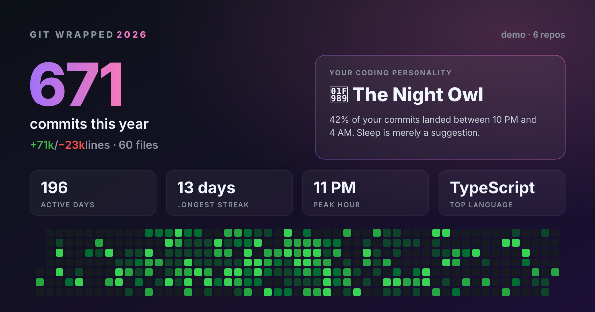

<div align="center">

# 🎁 git-wrapped

**Your year in git, wrapped.**

A Spotify-Wrapped-style recap of your commits, right in your terminal.
Streaks, a contribution heatmap, top languages, peak coding hours, your most-repeated commit message, your *coding personality*, and a card you can share.

Zero dependencies · Runs 100% locally · Works with any git repo (GitHub, GitLab, Bitbucket, self-hosted, or none at all)



<sub>Example card generated with <code>git-wrapped --demo --svg card.svg</code></sub>

</div>

---

## Quick start

```sh
git clone https://github.com/samcarrara415/Sams-repo.git
cd Sams-repo/git-wrapped
npm link            # installs `git-wrapped` (and `git wrapped`) on your PATH
```

Then, inside any repository:

```sh
git wrapped
```

Want to see it before pointing it at your own code?

```sh
git-wrapped --demo
```

Requires Node.js 18+ and git. No `npm install` step: there are no dependencies.

## What you get

```text
  ╭──────────────────────────────────╮
  │  DEMO'S 2026 IN GIT  ·  WRAPPED  │
  ╰──────────────────────────────────╯

  671 commits  across 6 repos
  +70,722 / −23,395 lines  ·  60 files touched
  196 active days  ·  longest streak 13 days (May 20 → Jun 1)

      Jan  Feb Mar Apr May  Jun Jul Aug  Sep Oct  Nov Dec
                 ▒▒▒█▒▒  ▓▓▒░░ █ ▒   ▓  ▓░░   ██      ░  ░
  Mon   ░   ▓      █▓░░░█░▒▒█  ▓▓▓▓▒▒  ░ ░░░░ ░      ██
        █  ▒░█ ░░█ ░░░░░▓▓ █ ▓▓█▓██░▓  █░ ░   ░░▓▒█    █
  Wed         ░░▒▓▓░░█░░░░░██▓▒░██▓▓ ░ ▓░▓     █▓  ░   ▒
        █ ░   █▓░▓ ░▓▓█▓ ██▒█▒░░▒▓▒█▒▓░ ░ ▒ ▒█          ▓ ▓
  Fri ▓  ▒█  ▓█ ▒ ░█░█ █▒█▓▒▒  ░░░░█▒▓ ░ ██▓▓█ ░ ▓ ▓  ▒ ░░
               ░ ▓   ▓ ░  ░▓ █▒▒ ▓▓█ ░█  ░░ ░ ▓ ▒    ▓   ░

  Rhythm
    Peak hour       11 PM   12a ▇▇▁▁▁▁▁▃▂▂▃▃▄▄▃▂▄▃▄▂▃▇▆█ 11p
    Favorite day    Friday
    Biggest month   July
    Busiest day     Jan 15 — 9 commits

  Top languages
    TypeScript  ██████████████░░░░░░░░░░  58%
    Python      ███░░░░░░░░░░░░░░░░░░░░░  11%
    Rust        ██░░░░░░░░░░░░░░░░░░░░░░  10%
    Go          ██░░░░░░░░░░░░░░░░░░░░░░   8%
    CSS         █░░░░░░░░░░░░░░░░░░░░░░░   4%

  Commit messages
    Most repeated   "make it faster" ×50
    Favorite words  fix ×170 · faster ×50 · flaky ×42 · test ×42
    Bug fixes       170

  Moments
    First commit    Jan 2  "ship it"
    Biggest commit  +405/−173  "fix typo" in side-quest
    Latest commit   Dec 31  "fix flaky test"
    Top repos       cli-tools (120) · web-app (118) · api-server (118)

  🦉  Your coding personality: THE NIGHT OWL
      42% of your commits landed between 10 PM and 4 AM. Sleep is merely
      a suggestion.
```

In a real terminal it's in full color, with a GitHub-green heatmap, and it reveals itself section by section.

### Coding personalities

| | Personality | You get it when… |
|---|---|---|
| 🦉 | The Night Owl | a big share of your commits land between 10 PM and 4 AM |
| 🌅 | The Early Bird | you ship before 9 AM |
| 🏕️ | The Weekend Warrior | Saturdays and Sundays are your prime time |
| 🐛 | The Bug Hunter | your commit log is mostly fixes |
| 🧹 | The Declutterer | you deleted more code than you wrote |
| 🏃 | The Marathoner | you kept up a 30-day-plus streak |
| ⚡ | The Sprinter | you pack 10+ commits into a coding day |
| 🌍 | The Polyglot | you wrote real code in 6+ languages |
| 🚢 | The Steady Shipper | none of the above. Just consistent, quiet shipping |

Got an idea for a new one? [Open a PR](#contributing). Personalities live in [`src/analyze.js`](src/analyze.js).

## Usage

```sh
git-wrapped                                  # the repo you're in, your commits, this year
git-wrapped --scan ~/code                    # every repo under ~/code, combined
git-wrapped --scan ~/code --svg wrapped.svg  # ...and save a shareable card
git-wrapped --year 2025                      # look back at last year
git-wrapped --author octocat --author oct@cat.dev   # match other identities you commit with
git-wrapped --everyone                       # the whole team's year, not just yours
git-wrapped --json > stats.json              # raw numbers for your own charts
```

| Option | Description |
|---|---|
| `--year <yyyy>` | Year to wrap (default: this year) |
| `--scan <dir>` | Find every git repo under `<dir>` and combine them |
| `--author <pattern>` | Count commits whose `Name <email>` contains `<pattern>`. Repeatable. Defaults to your `user.name` and `user.email` |
| `--everyone` | Count every author's commits |
| `--all` | Include all local and remote branches and tags, not only `HEAD` |
| `--name <name>` | Name shown on the card (default: `git config user.name`) |
| `--svg <file>` | Write a 1200×630 card, sized for social media previews |
| `--json` | Print the stats as JSON |
| `--demo` | Use generated sample data |
| `--no-anim` / `--no-color` | Plain output. `NO_COLOR` is respected, and piped output is never colored |

## Put it on your GitHub profile

```sh
git-wrapped --scan ~/code --svg wrapped-2026.svg
```

Commit `wrapped-2026.svg` to your `<username>/<username>` profile repository and add it to the README:

```md

```

## How it works

- Reads `git log --numstat` from each repository. Nothing leaves your machine: no network calls, no telemetry, no accounts.
- Hours are taken in the **author's local time**, so a commit made at 11 PM in Tokyo counts as 11 PM.
- Lockfiles, `dist/`, `build/`, `vendor/`, `node_modules/`, minified bundles, source maps and snapshots don't count toward your line totals or languages.
- Merge commits are skipped, and commits that show up in several clones are only counted once.
- Languages are weighted by lines changed, not file count.

## FAQ

**It says I have no commits.**
You probably commit under a different email (for example a `users.noreply.github.com` address). Add it with `--author`, or use `--everyone` in a repo that's only yours.

**Can I run it on a private or work repo?**
Yes. It never uploads anything. Be careful what you *share*, though: the card shows repo counts and the terminal output shows commit messages.

**Does it work on Windows?**
It should: it only needs `git` and Node 18+ on your `PATH`, and Windows Terminal shows the colors best. If something breaks, please open an issue.

## Contributing

PRs are very welcome, especially new personalities, more language mappings, and new stats.

```sh
npm test         # node's built-in test runner, no setup
npm run demo     # try your changes against the sample data
```

Code layout:

```
bin/git-wrapped.js     CLI and argument parsing
src/collect.js         finding repos, reading and parsing git log
src/analyze.js         stats, streaks, heatmap, personalities
src/render-terminal.js terminal output
src/render-svg.js      the shareable card
src/languages.js       file extension → language, noise filters
```

## License

[MIT](LICENSE)
